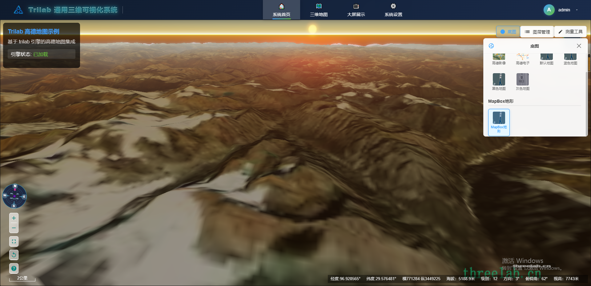
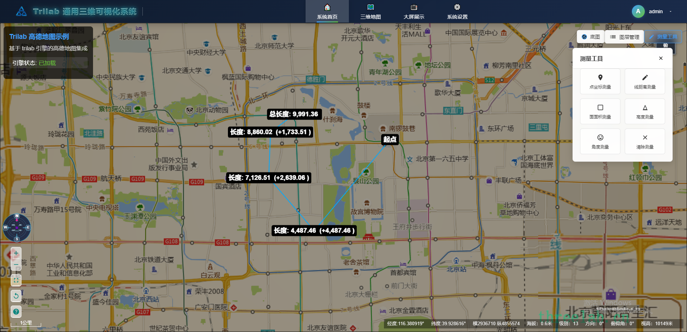

# trilab-vue-project: 基于Vue 3.x技术栈的Trilab三维可视化平台基础项目





## 项目介绍

Trilab 基础项目是基于Trilab三维引擎平台开发的一个应用系统，提供的基础项目模板包含常用三维地图功能，可在该基础项目上快速开发搭建新项目。方便快速搭建三维地图产品，敏捷开发，可复用，支持各种配置，适合各种场景使用。

- **项目地址**: [https://github.com/AivoGenX/trilab-vue-project.git](https://github.com/AivoGenX/trilab-vue-project.git)
- **官网地址**: [https://threelab.cn/](https://threelab.cn/)

## 项目特性

- **最新技术栈**：使用 Vue3/Vite 等前端前沿技术开发
- **TypeScript支持**：应用程序级 JavaScript 的语言
- **模块化设计**：采用组件化架构，便于功能扩展和维护
- **三维可视化**：集成Trilab三维引擎，支持高性能三维渲染
- **响应式设计**：适配不同屏幕尺寸和设备

## 技术架构

### 技术选型

- **Vue 3**：现代化前端框架，使用 Composition API
- **Vite**：下一代前端构建工具，快速开发体验
- **Trilab Engine**：专业的三维可视化引擎
- **Three.js**：底层3D图形库支持
- **Element Plus**：UI组件库
- **Axios**：HTTP请求库
- **Pinia**：状态管理
- **TypeScript**：类型安全的JavaScript

### 主要目录说明

```
trilab-vue-project
└───src                 主要项目代码
│   └───assets          静态资源
│   └───components      公共组件
│       └───AppHeader.vue           应用头部组件
│       └───BasemapSwitcherButton.vue 底图切换按钮
│       └───BasemapSwitcherPanel.vue  底图切换面板
│       └───LayerManagerButton.vue   图层管理按钮
│       └───LayerManagerPanel.vue    图层管理面板
│       └───MapControls.vue           地图控制组件
│       └───ToolsManagerButton.vue    工具管理按钮
│       └───ToolsManagerPanel.vue     工具管理面板
│   └───App.vue         主应用组件
│   └───main.js         应用入口
│   └───TriLab.js       Trilab引擎封装
│
└───public              静态资源
│   └───favicon.ico     网站图标
│
└───build               构建脚本
└───mock                模拟数据
└───plugins             Vite插件
│
│─── package.json       项目配置信息
└─── vite.config.js     Vite 配置文件
└─── index.html         应用入口页面
```

## 功能特性

### 三维地图功能

- **多源底图支持**：高德地图、卫星影像、MapBox地形等
- **图层管理**：支持图层显示/隐藏、透明度调节
- **测量工具**：点坐标、线距离、面面积、高度、角度测量
- **地图控制**：缩放、平移、全屏、指北针等
- **交互操作**：鼠标、触摸手势支持

### 界面组件

- **应用头部**：Logo、菜单导航、用户信息
- **底图切换器**：多种地图样式切换
- **图层管理器**：图层控制面板
- **工具管理器**：测量工具面板
- **地图控制器**：地图操作控件

## 快速开始

### 环境要求

- Node.js 18+ 版本
- npm 或 yarn 包管理器
- 现代浏览器（推荐 Chrome 90+）

### 下载运行项目

1. **下载代码**

```bash
# 克隆项目
git clone https://github.com/AivoGenX/trilab-vue-project.git

# 进入项目目录
cd trilab-vue-project
```

2. **安装依赖**

```bash
# 使用 npm
npm install

# 或使用 yarn
yarn install

# 或使用国内镜像（推荐）
npm install --registry=https://registry.npmmirror.com
```

3. **启动开发环境**

```bash
npm run dev
```

4. **编译构建**

```bash
# 生产环境构建
npm run build

# 预览构建结果
npm run preview
```

### 浏览器支持

| 浏览器 | 支持版本 |
|--------|----------|
| Chrome | 90+      |
| Firefox | 最新版本 |
| Safari | 最新版本 |
| Edge | 最新版本 |

## 功能演示

### 基础地图功能

- 高德电子地图显示
- 高德卫星影像
- MapBox地形数据
- 多种地图样式切换

### 图层管理

- 图层显示/隐藏控制
- 图层透明度调节
- 图层搜索功能
- 批量图层操作

### 测量工具

- **点坐标测量**：获取地理坐标信息
- **线距离测量**：测量两点间距离
- **面面积测量**：测量多边形区域面积
- **高度测量**：测量高程信息
- **角度测量**：测量角度值

### 地图控制

- 缩放控制按钮
- 平移操作
- 全屏显示
- 指北针指示
- 操作指南

## 开发指南

### 项目结构说明

项目采用模块化设计，主要功能组件位于 `src/components` 目录下：

- **AppHeader.vue**：应用头部组件，包含Logo和菜单
- **BasemapSwitcher***：底图切换相关组件
- **LayerManager***：图层管理相关组件
- **ToolsManager***：工具管理相关组件
- **MapControls.vue**：地图控制组件

### Trilab引擎集成

项目通过 `src/TriLab.js` 文件集成Trilab三维引擎，提供以下功能：

- 地图初始化配置
- 图层管理API
- 测量工具集成
- 事件处理机制

### 自定义开发

如需添加新功能，可以参考现有组件结构：

1. 在 `src/components` 目录下创建新组件
2. 在主应用 `App.vue` 中引入组件
3. 配置相应的样式和交互逻辑

## 配置说明

### 环境配置

项目支持多环境配置：

- `.env.development`：开发环境配置
- `.env.production`：生产环境配置

### 地图配置

地图相关配置在组件内部管理，支持：

- 地图中心点设置
- 缩放级别配置
- 地图控件配置
- 图层参数设置

## 常见问题

### Q: 如何添加新的底图类型？

A: 在 `BasemapSwitcherPanel.vue` 组件中添加新的底图配置，并实现相应的图层创建逻辑。

### Q: 如何扩展测量工具？

A: 在 `ToolsManagerPanel.vue` 组件中添加新的测量功能，并集成到Trilab引擎中。

### Q: 项目支持移动端吗？

A: 项目采用响应式设计，支持移动端访问，但部分功能在移动端可能需要优化。

## 贡献指南

欢迎提交问题和改进建议：

1. 提交Issue报告问题
2. 提交Pull Request贡献代码
3. 完善文档和示例

## 许可证

本项目基于MIT许可证开源。

## 联系方式

- **项目主页**: [https://github.com/AivoGenX/trilab-vue-project.git](https://github.com/AivoGenX/trilab-vue-project.git)
- **官网地址**: [https://threelab.cn/](https://threelab.cn/)
- **问题反馈**: [GitHub Issues](https://github.com/AivoGenX/trilab-vue-project/issues)
- **邮箱联系**: [项目维护团队邮箱]

---

**Trilab三维可视化平台** - 让三维可视化更简单！